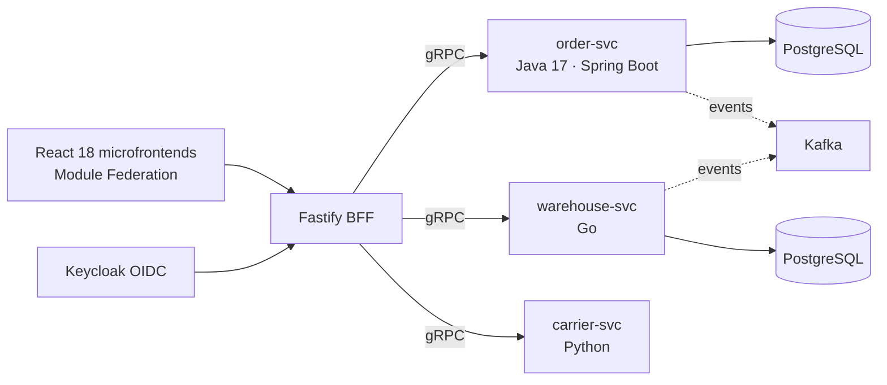
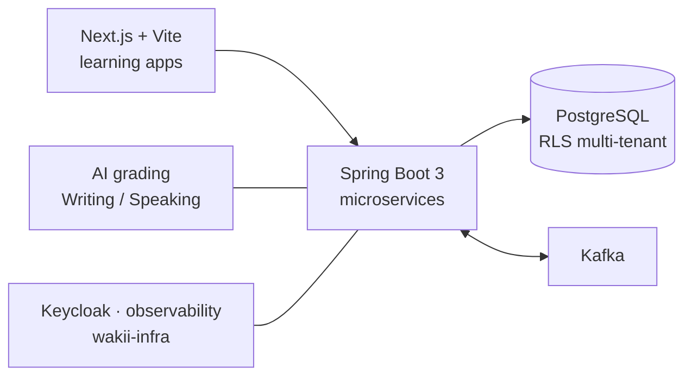

  

  

  🌐 <a href="https://wakii.dev"><b>wakii.dev</b></a> · <a href="https://github.com/wakii-dev/wakii-site">wakii-site</a> · <a href="https://github.com/wakii-dev/hub-store">hub-store</a>

---

## 🖥️ How I ship

|  | **Human × AI agents** — specs and judgment from me, execution at agent speed (Claude, Kiro).  Every project here — including the 2.5M-order logistics platform — was built in this loop: **spec → plan → parallel agents → review → ship.** |
| -------------------------------------------------------------------- | ----------------------------------------------------------------------------------------------------------------------------------------------------------------------------------------------------------------------------------------------- |

## 🤖 The agent crew (my contributors)

  

*9 agents ship with every Wakii install. The site, the IDE docs, this profile
and the 2.5M-order platform below were all spec'd, built and reviewed by this
crew — the profile is the demo.*

## ⚙️ The pipeline

  

## 🚀 What I'm building

### ⚡ [Wakii](https://wakii.dev) — agentic IDE (ADE)
> The desktop for working with a **fleet of parallel coding agents** — run any
> coding agent with your own subscription. Available on desktop, mobile & VPS.

- Core: [`wakii`](https://github.com/wakii-dev/wakii) (TypeScript) · site: [wakii.dev](https://wakii.dev) → [`wakii-site`](https://github.com/wakii-dev/wakii-site) (Astro)
- Docs, skills catalog (20 built-in skills), public roadmap & downloads

### 🏗️ hub-store — fulfillment operations platform *(private — architecture below)*
> Production-grade logistics platform exercised at **2.5M+ orders / year scale**:
> order coordination, warehouse picking batches, D2C carrier hand-off,
> technician dispatch, COD settlement, label printing.

- Polyglot microservices over **gRPC** · PostgreSQL dual-DB · Kafka side-channel
- **Full QA story**: role-matrix regression suites, Playwright e2e, CI on Actions

### 🎯 wakii-english — AI IELTS prep for Vietnamese learners *(private — architecture below)*
> AI scores Writing/Speaking to **≤ 0.5 band accuracy**, builds a personalized
> roadmap, runs a multi-tenant LMS.

### 🧪 More builds
- 🎧 [`iloveenglishclub`](https://github.com/wakii-dev/iloveenglishclub) — English listening
  dictation practice following the Cambridge Prepare path (Pre-A1 → B2 First)
  · Next.js 15 + Drizzle + Auth.js + Neon Postgres
- 🛒 [`ecommerce`](https://github.com/wakii-dev/ecommerce) — Spring Boot 3 microservices +
  React/Vite microfrontends (Module Federation), Tiki-inspired storefront
  · PostgreSQL · Redis · RabbitMQ · MongoDB · Elasticsearch · Stripe
- 🔌 `cc-driver` *(private)* — TypeScript driver to orchestrate Claude Code headless
  (agents, pools, goal/loop, background jobs) + schema-validated LLM calls
  · GLM (z.ai) / Claude multi-provider, zero runtime deps

## 🧰 Stack I work with

## 📊 Mission control

  

## 🧊 Contributions in 3D

  

## 🐍 Snake

  

---

  

<i>Building in public, one agent-crew sprint at a time. 🤖</i>

